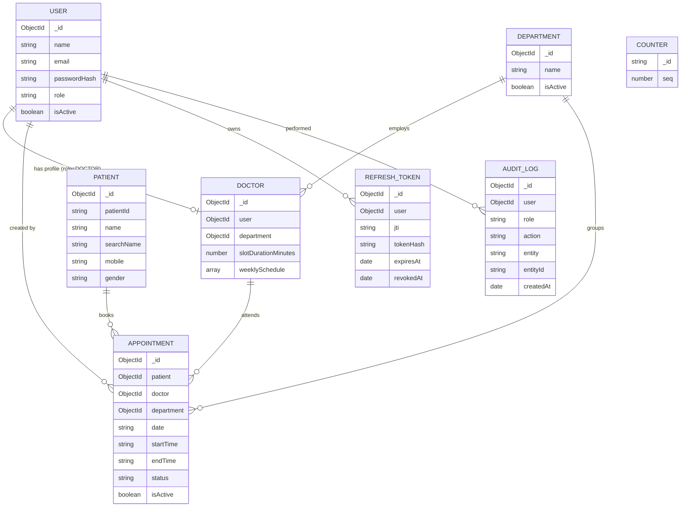

# Database Design (MongoDB + Mongoose)

## Entity relationship diagram



## Collections

| Collection | Purpose | Relationships |
|---|---|---|
| `users` | Login identities for all three roles. Password stored only as a bcrypt hash (`select: false`). | 1 user : 0..1 doctor profile |
| `doctors` | Doctor profile and **schedule rules** (not slots). | `user`, `department` references |
| `departments` | Medical departments. | 1 department : N doctors |
| `patients` | Patient master record. `patientId` is a human friendly id (`P-000042`). | 1 patient : N appointments |
| `appointments` | One booking of one slot. Holds a denormalised snapshot of patient/doctor names for fast search. | references patient, doctor, department, creator |
| `refreshtokens` | Server side record of issued refresh tokens (hash only) for rotation, reuse detection and logout. TTL index deletes expired rows. | `user` |
| `auditlogs` | Append-only trail of important actions. | `user` (optional for failed logins) |
| `counters` | Atomic sequence used to generate patient ids. | none |

## Why slots are NOT stored
Only the *rules* (sessions, breaks, slot length) live in `doctors.weeklySchedule`. Slots are generated on request by a pure function, then compared with booked appointments. Benefits: a schedule change is instantly correct everywhere, there are no millions of pre-created empty slot rows, and there is no stale data to clean up.

## Indexes

| Collection | Index | Why |
|---|---|---|
| appointments | `{doctor, date, startTime}` **unique, partial (`isActive: true`)** | **Double booking guard.** Also serves "all bookings of doctor X on date Y" (slot grid) and doctor-scoped lists. |
| appointments | `{date, startTime}` | Date-range lists, today's queue, dashboard stats; default sort. |
| appointments | `{department, date}` | Department filter + date range. |
| appointments | `{status, date}` | Status filter + date range. |
| appointments | `{patientMobile}` | Mobile prefix search. |
| appointments | `{patientNameLower}` | Patient name prefix search. |
| appointments | `{doctorNameLower}` | Doctor name prefix search. |
| patients | `{patientId}` unique | Lookup and uniqueness of the public id. |
| patients | `{mobile}`, `{searchName}` | Booking-time patient search (prefix). |
| users | `{email}` unique | Login lookup. |
| doctors | `{user}` unique, `{department, isActive}` | Profile lookup, doctors of a department. |
| refreshtokens | `{jti}` unique, `{user}`, `{expiresAt}` TTL | Rotation lookups, revoke-all, auto cleanup. |
| auditlogs | `{createdAt:-1}`, `{user, createdAt:-1}`, `{entity, entityId}` | Newest first, per-user and per-entity history. |

## Query optimisation strategy
- **No joins on hot paths.** `appointments` stores `patientName`, `patientMobile`, `patientCode`, `doctorName`, `departmentName`. The list endpoint is one indexed `find` + one `countDocuments`, run in parallel, with `.lean()` and projections.
- **Prefix, not contains.** Name search uses `^term` on a lowercased indexed field, which MongoDB can serve from the index (an unanchored regex would scan the collection).
- **Stable pagination.** Every sort ends with `_id` as a tie breaker; page size is capped at 100; sort fields are whitelisted.
- **One query per concern.** Slots for N doctors need a single booked-appointments query (no N+1). Dashboard counters are one `$group` aggregation.
- **Trade-off of denormalisation:** if a patient/doctor is renamed, old appointments keep the old name (acceptable for a record of what happened; a back-fill job can be added).

## Sample documents

```jsonc
// doctors
{
  "_id": "66a1…", "user": "66a0…", "department": "669f…",
  "specialization": "Physician", "slotDurationMinutes": 15, "isActive": true,
  "weeklySchedule": [
    { "dayOfWeek": 1,
      "sessions": [
        { "name": "Morning Session", "startTime": "09:00", "endTime": "12:00" },
        { "name": "Evening Session", "startTime": "13:00", "endTime": "17:00" } ],
      "breaks": [ { "name": "Lunch Break", "startTime": "12:00", "endTime": "13:00" } ] }
  ]
}

// patients
{ "_id": "66b2…", "patientId": "P-000042", "name": "Asha Verma", "searchName": "asha verma",
  "mobile": "9876543210", "gender": "FEMALE", "dateOfBirth": "1992-04-18" }

// appointments
{ "_id": "66c3…", "patient": "66b2…", "doctor": "66a1…", "department": "669f…",
  "date": "2026-10-20", "startTime": "09:15", "endTime": "09:30",
  "status": "SCHEDULED", "isActive": true, "purpose": "Fever for 3 days",
  "patientName": "Asha Verma", "patientNameLower": "asha verma", "patientMobile": "9876543210",
  "patientCode": "P-000042", "doctorName": "Dr. Anil Sharma", "doctorNameLower": "dr. anil sharma",
  "departmentName": "General Medicine", "createdBy": "66a0…" }

// auditlogs
{ "user": "66a0…", "role": "RECEPTIONIST", "action": "APPOINTMENT_CREATED", "entity": "Appointment",
  "entityId": "66c3…", "metadata": { "date": "2026-10-20", "startTime": "09:15" },
  "ip": "203.0.113.7", "createdAt": "2026-10-15T09:41:07.000Z" }
```
